# Repository Architecture

```mermaid
flowchart TB
    subgraph INPUTS["Local inputs (gitignored, never pushed)"]
        V["local_sources/videos/*.mp4<br/>(3 videos, SHA-256 pinned<br/>in data/source_manifest.json)"]
    end

    subgraph SCRIPTS["scripts/ (reproducible pipeline)"]
        IM["inspect_media.py<br/>codec/frame-count/hashes"]
        AE["analyze_flash.py<br/>signed-difference flash mask"]
        AF["audit_puzzle1_flash.py<br/>flash glyph adjudication"]
        DE["decode_part1_edges.py<br/>edge-fragment join + report"]
        DC["decode_part2_column.py<br/>state machine + windows + report"]
        ER["extract_reconstructions.py<br/>A/C layers, rasters, agreement"]
        AD["inspect_aac_diffs.py<br/>audio packet/PCM audit"]
        VE["verify_ethereum.py<br/>offline secp256k1+Keccak oracle"]
    end

    subgraph TESTS["tests/ (deterministic, video-free)"]
        T1["test_oracle.py"]
        T2["test_input_integrity.py"]
        T3["test_reconstruction_math.py"]
        T4["test_flash_audit_logic.py"]
        T5["test_decoder_logic.py"]
    end

    subgraph DATA["data/ (tracked, machine-readable)"]
        D1["source_manifest.json"]
        D2["hypotheses.json"]
        D3["evidence/ (ASCII extractions,<br/>glyph adjudication JSONs)"]
    end

    subgraph DOCS["docs/"]
        DOC["FINDINGS · EVIDENCE_DOSSIER · SOURCES ·<br/>RESEARCH_PLAN · EXPERIMENT_LEDGER ·<br/>PUZZLE1_CONTROL · FAQ · PUBLISHING_AND_RIGHTS"]
    end

    R["results/ (generated locally, gitignored)"]
    OUT["Candidate strings<br/>6A6B0860B4 · 723504 · C8"]

    V --> IM & AE & AF & DE & DC & ER & AD
    IM --> R
    AE --> AF --> R
    DE --> R
    DC --> R
    ER --> R
    AD --> R
    OUT --> VE
    VE -->|"address == escrow?"| SOL["SOLVED (nothing verified yet)"]
    VE -->|"no"| OPEN["status stays OPEN"]
    T1 & T2 & T3 & T4 & T5 --> CI["CI (see docs/ci-workflow.yml<br/>until workflow scope is granted)"]
    D1 & D2 & D3 -.-> SCRIPTS
    DOC -.-> README["README.md"]
```

## Data flow in one paragraph

Copyrighted videos stay under `local_sources/` (gitignored). Every script
consumes them read-only and writes derived artifacts to `results/`
(gitignored) plus compact, copyright-safe machine evidence: JSON reports with
ASCII renderings, geometry, and statistics. The machine-readable hypothesis
register (`data/hypotheses.json`) records every candidate with a
classification (`verified_observation` / `replicated_candidate` /
`model_conditioned_candidate` / `speculative_assembly`) and a
`cryptographically_verified` flag that is false until
`verify_ethereum.py --candidate <64-hex>` derives the escrow address. The
pure-Python oracle is deliberately dependency-free and validated against the
public Puzzle 1 vector and Keccak test vectors, with a recommended
cross-check against `eth_keys`. CI runs only the deterministic tests and the
oracle self-test — no private assets are required.

## Separation of evidence classes

| Class | Meaning | Example |
| --- | --- | --- |
| VERIFIED OBSERVATION | reproduces from raw pixels/bytes with pinned parameters | flash exists at frames 727–728; B = A∪C at 99.8% |
| REPLICATED (parameter-dependent) | reproduced by us, but sensitive to documented parameters | `6A6B0860B4` reading; `723504` raster |
| MODEL-DEPENDENT | requires a font/geometry assumption to read at all | six-slot column decoding; `723604` alternative |
| HYPOTHESIS | assembly speculation; falsifiable, untested or unproved | four-16-hex-blocks; `C8` as key data |
| NEGATIVE TEST | tested and did not reproduce the hoped-for signal | no hidden key flash; audio = encoder artifact |
| EXTERNAL CLAIM | third-party statement not yet reproduced by us | statement-video flashes; description typos |
